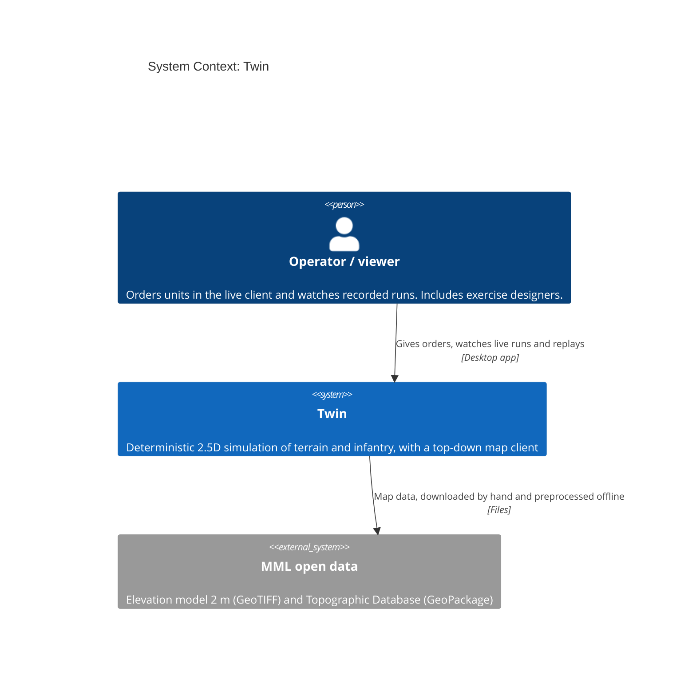
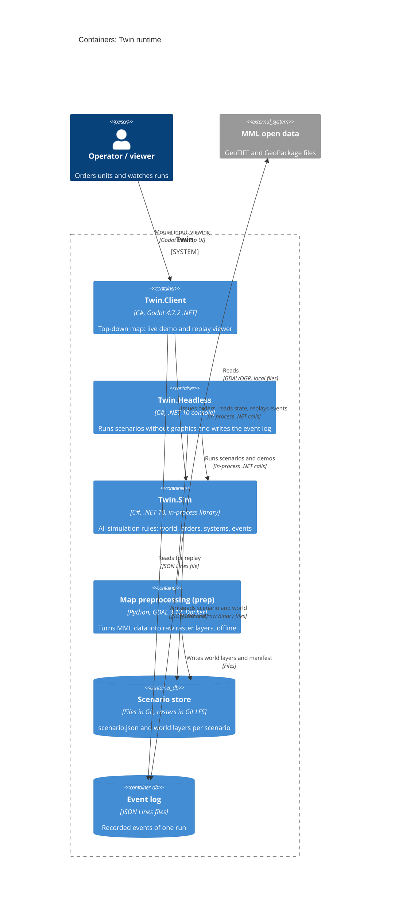
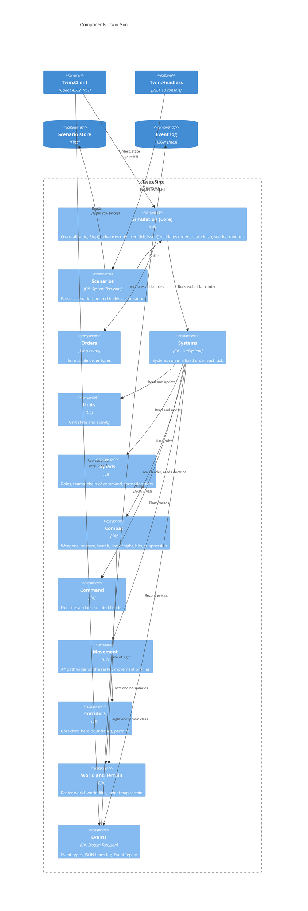
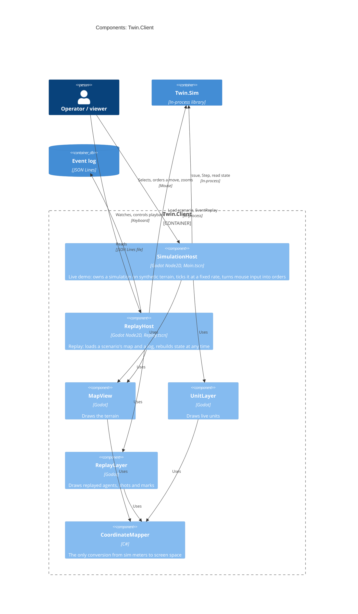

# Technical Overview

As of PR #22 (`d180154`), 2026-11-19. Decisions behind most of what follows are in [`docs/adr/`](../adr/README.md).

Owner: Team 10. Maintained by hand; update it when the architecture changes significantly.

## 1. Overview

### Problem and users

The team is building a digital twin of a military operating environment: terrain plus agents that move, observe and
fight in it by explicit, testable rules. The backlog names two users: operators, who order units and watch them carry
the orders out, and exercise designers, who place agents and squads on real terrain and watch them engage.

> TODO: state the purpose the twin serves (for example training, exercise planning or analysis) and who owns it.

### Solution

Twin is a deterministic 2.5D simulation of terrain and infantry, written as a plain .NET library (`Twin.Sim`) and fed
with National Land Survey of Finland (MML) open data that is preprocessed offline. A Godot 4 client shows it as a
top-down map, and a headless runner runs the same library for CI and scenario runs; runs are recorded as an event log
that the client can replay. The repository is a walking skeleton: every feature goes end to end through the same
test-driven, AI-assisted workflow.

### Scope boundaries

- 2.5D world: one ground height per map position ([ADR 0004](../adr/0004-world-model-2-5d.md)).
- Walking infantry and squads only.
- No external C2: a scripted Leader inside `Twin.Sim` stands in for a real commander.
- Single process, no networking: units integrate through files and in-process calls.
- Map data is preprocessed offline; only open or synthetic data is allowed ([ADR 0008](../adr/0008-tdd-and-ai-harness.md)).

## 2. Architecture

### 2.1 System Context (C4 Level 1)

MML open data is the only external system, and it is used offline: files are downloaded by hand, preprocessed and
committed. At run time Twin talks to no external system. Orders come from the operator, and a commander's answers come
from an internal scripted leader. Operators and exercise designers are shown as one person because they use the same
client.

### 2.2 Containers (C4 Level 2)

`Twin.Sim` is shown as a container although it is an in-process library, which C4 would normally model as a
component: it is the shared core of the client, the headless runner and the tests, and its component diagram is the
most important one. Every relationship is an in-process call or a file, and no container listens on a network port.
The event log is the only hand-over between the headless runner and the client.

| Container | Responsibility | Technology |
| --- | --- | --- |
| Twin.Sim | All rules: terrain, movement, corridors, combat, suppression, squads; deterministic tick; event log | C#, .NET 10 class library |
| Twin.Client | Draws the map and units; live demo with mouse orders; replays an event log | C#, Godot 4.7.2 .NET |
| Twin.Headless | Runs the simulation without graphics: CI smoke run, scenario runs, built-in demos | C#, .NET 10 console app |
| Map preprocessing (prep) | Turns MML data into height, terrain-class and cliff files | Python 3, GDAL 3.12, Docker |
| Scenario store | One folder per scenario: scenario definition and world layers | JSON, raw binaries, Git LFS |
| Event log | One run's events, reproducible byte for byte | JSON Lines |

### 2.3 Components (C4 Level 3)

The Scenario store and the Event log have no component diagrams: they are files with no logic of their own.

#### 2.3.1 Twin.Sim

Simulation is the only entry point: callers issue orders and step time, and code outside the library sees state
read-only. Behaviour lives in the systems, and their fixed order is part of the behaviour. Rule values and doctrine
are data with defaults that scenarios and tests can override.

#### 2.3.2 Twin.Client

The client has two independent modes: a live demo on synthetic terrain, and a replay viewer that shows real MML
terrain. The replay viewer runs no simulation; it rebuilds the state from the log, so it shows exactly what was
recorded. The client holds no game rules ([ADR 0002](../adr/0002-simulation-presentation-separation.md)).

#### 2.3.3 Twin.Headless

Twin.Headless is a thin console front end to Twin.Sim: it runs a demo for the CI smoke run, or runs a scenario until
it is over and writes its event log.

#### 2.3.4 Map preprocessing (prep)

Map preprocessing is a Python and GDAL command-line tool, run in Docker, that turns MML source files into the raster
layers, cliff lines and checksummed manifest of a scenario's world.

### 2.4 Architectural Principles

> **DRAFT — to be validated by the team.**

1. **Simulation core independent of any engine** ([ADR 0002](../adr/0002-simulation-presentation-separation.md)) — rules outlive engines, and tests, replays and batch
   runs need them without graphics.
2. **Deterministic by construction** ([ADR 0005](../adr/0005-determinism.md)) — tests, replays and debugging need identical runs from the same seed
   and orders.
3. **Units integrate through files, not networks** (no ADR yet) — files are easy to inspect, version and reproduce.
4. **One frame of reference: SI units, X east, Y north, Z up** ([ADR 0003](../adr/0003-coordinates-and-units.md)) — "go to X, Y, Z" must mean the same thing
   to everyone.
5. **Rule values and doctrine are data** (no ADR yet) — values need calibration, and doctrine is decided by people,
   not by code.
6. **Tests are the specification, enforced by tooling and explained by ADRs** ([ADR 0001](../adr/0001-record-decisions.md), [ADR 0006](../adr/0006-code-quality-gates.md), [ADR 0008](../adr/0008-tdd-and-ai-harness.md)) — people and AI
   agents follow rules more reliably when hooks, CI and quality gates enforce them and ADRs give the reasons.

## 3. Technologies

Versions come from `global.json`, `Directory.Packages.props`, the project files, `.godot-version`, the Dockerfiles
and `prep/requirements.txt`.

| Component | Language/runtime | Frameworks | Testing | Lint/format | Build |
| --- | --- | --- | --- | --- | --- |
| Twin.Sim | C# latest, .NET 10 (SDK 10.0.100) | – (base library only) | xUnit projects: Sim, Scenarios, Architecture, Acceptance | `.editorconfig`, `dotnet format`, nullable, warnings as errors | MSBuild, central package management |
| Twin.Client | C# latest, .NET 10 | Godot 4.7.2 .NET, GL Compatibility renderer | – | `.editorconfig`, nullable; warnings not errors | Godot.NET.Sdk 4.7.2 |
| Twin.Headless | C# latest, .NET 10 | – | 60 s smoke run in CI | As Twin.Sim | MSBuild console app |
| prep | Python 3 (not pinned) | GDAL/OGR 3.12.0, numpy (not pinned) | pytest 8.3.4 | – | Docker (`ghcr.io/osgeo/gdal:ubuntu-small-3.12.0`) |
| Test suites | C# latest, .NET 10 | xUnit 2.9.3, scenario kit (Twin.Testing) | – | As Twin.Sim | MSBuild; xunit.runner.visualstudio 3.0.2, Microsoft.NET.Test.Sdk 17.12.0 |

The test suites and the dev tooling are used only during development, so the runtime container diagram does not show
them. The scenario store holds JSON plus raw little-endian rasters (in Git LFS), and the event log is JSON Lines; `Twin.Sim`
reads and writes both with the .NET base library only.

| Area | Technology | Notes |
| --- | --- | --- |
| CI | GitHub Actions (`checkout`, `setup-dotnet`, `upload-artifact`, all v4) | Format check, build, tests and a 60 s headless run on Ubuntu and Windows; tests in Docker; no deployment |
| Containers | Docker: `mcr.microsoft.com/dotnet/sdk:10.0.100` (tests), GDAL image (prep) | – (no compose, no orchestration) |
| Dependency policy | Central package management | Exact versions, 14-day rule, one PR per package change ([ADR 0006](../adr/0006-code-quality-gates.md)) |
| AI harness | Claude Code hooks, permissions, skills, reviewer subagent | Enforce the TDD phase and green tests ([ADR 0008](../adr/0008-tdd-and-ai-harness.md)) |
| Version control | Git, Git LFS | Rasters and binary assets in LFS |

## 4. Open items

- No deployment target, Godot export presets or release pipeline: CI builds and tests only.
- The live client runs on synthetic terrain; only replay mode uses real MML data.
- [ADR 0007](../adr/0007-tech-stack.md) is out of date: it names rasterio/geopandas and `tools/` for map preprocessing; the actual stack is GDAL/OGR, numpy and `prep/`.
- Tooling gaps: prep's Python is not pinned, prep has no linter, Actions are pinned to tags not SHAs, Twin.Client is not format-checked in CI (outside `Twin.Core.slnf`), and the reason for Linux plus Windows CI is undocumented (TODO).
